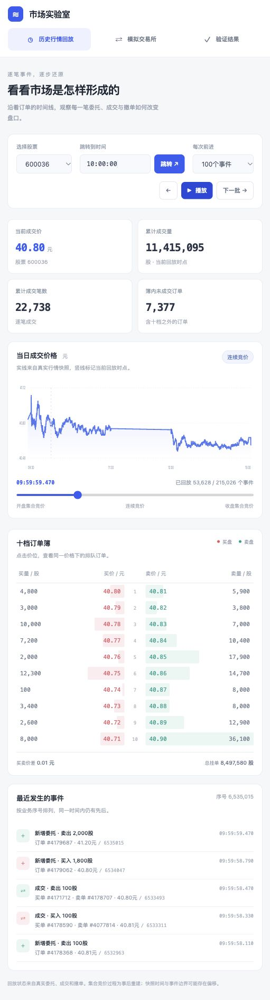

# 第三讲实践课 高频数据与模拟交易所作业报告

作者：Chuboxiao

完成日期：2026年10月9日

课程任务：[第三节实践课 Issue 6](https://github.com/aslan9/pku_quantllm/issues/6)

数据日期：2026年9月23日

本次作业围绕课堂提出的“熟悉高频数据、维护订单簿、模拟撮合”展开。我实现了一个 Python 撮合引擎和可操作的网页，处理了课程数据包中的50只股票，并逐条核对生成成交和最终订单簿。全量结果表明，在本项目的数据补回与验证口径下，成交配对、成交顺序、最终订单簿和同价队列均一致。由于源委托披露的是首次撮合后的剩余量，真实成交参与了主动订单输入的补回；结果应理解为历史一致性验证。

## 任务目标与完成内容

任务可以拆成两个相互关联的问题。第一个问题是：一笔新增订单、成交或撤单发生后，市场上还剩下哪些订单？这需要维护完整订单簿，并能查询每个事件后的状态。第二个问题是：给定原始订单和交易规则，交易所怎样选择对手方、确定成交价与成交量？这需要撮合引擎。

本项目完成了以下内容：

| 要求 | 实现 | 查看位置 |
| --- | --- | --- |
| 理解高频数据 | 字段、单位、编码、通道与事件顺序检查 | `exchange/data.py`、`results/data_profile.json` |
| 建立完整订单簿 | 买卖价位排序、同价FIFO队列、按订单号撤单 | `exchange/book.py` |
| 模拟交易规则 | 连续竞价、部分成交、撤单、开收盘集合竞价 | `MatchingEngine` |
| 获得事件时点的订单簿 | 按时间或业务序号重放，导出全部未成交订单 | `main.py book`、`exchange/replay.py` |
| 生成并核对成交 | 补回主动订单输入，独立执行撮合，再比较真实成交 | `exchange/simulate.py` |
| 网页展示 | 历史回放、十档盘口、队列查看、交互下单与撤单 | `webapp.py`、`web/` |

## 数据组成与字段语义

数据来自[课程官方 Release](https://github.com/aslan9/pku_quantllm/releases/tag/data-sse50-20260923)。压缩包 SHA-256 为 `18c0e124a9c68eb2f77b965ca1f29c93bb30339d7db45245e1af3c0420c6c947`。下载脚本会验证压缩包和解压后的三个文件。

| 文件 | 实测记录数 | 本项目的用途 |
| --- | ---: | --- |
| `ord_20260923.parquet` | 6,276,360 | 新增剩余委托、撤单、交易阶段状态 |
| `exe_20260923.parquet` | 3,792,934 | 真实成交、买卖双方订单号、主动方向 |
| `snp_20260923.parquet` | 252,631 | 十档价量、累计成交量与笔数、总委托量核对 |

三个文件都覆盖50只股票。每只股票维护独立订单簿。`Symbol` 是证券代码，`Time` 采用 `HHMMSSmmm` 编码，例如 `93000030` 表示09:30:00.030。源价格是以元计的 float32，系统将其归一为整数分；数量使用整数股。

逐笔事件在同一个竞价 `Channel` 内按 `BizIndex` 排序。原始订单号使用 `OrderOriNo`，与成交里的 `BidOrder`、`AskOrder` 关联。`OrderKind` 的65、68、83分别对应ASCII字符A、D、S，即新增、撤单、状态。买卖方向66、83对应B、S。数据包筛选了成分股，所以通道业务序号跳号本身不能证明消息缺失。

最需要注意的是新增委托的含义：它并不一定是投资者刚提交时的完整数量。连续竞价中，订单首次撮合后才披露剩余委托；完全成交的主动订单可能没有剩余新增消息。这一处理依据[上交所LDDS竞价Level-2接口说明书](https://bsp.sseinfo.com/admin/static/public/2024-06-07/13f94744fb6244d5a21ee42bddcec9f6/%E4%B8%8A%E6%B5%B7%E8%AF%81%E5%88%B8%E4%BA%A4%E6%98%93%E6%89%80LDDS%E7%B3%BB%E7%BB%9F%E7%AB%9E%E4%BB%B7Level-2%E8%A1%8C%E6%83%85%E6%8E%A5%E5%8F%A3%E8%AF%B4%E6%98%8E%E4%B9%A6.pdf)第4.3、4.4节，并通过本包样本和全量结果核对。该文档是接口语义参考，字段映射以课程文件的实际结构为准。

## 订单簿与撮合规则实现

订单簿同时保存订单号索引和价格队列。买价由高到低取最优价，卖价由低到高取最优价；每个价位用有序队列保留到达顺序。十档盘口只是对完整订单簿的汇总展示，十档之外的委托同样保留。按订单号可以直接定位撤单对象，减少数量后同步更新价位总量和买卖总量。

连续竞价处理每一笔新限价单。买单限价达到最优卖价，或卖单限价低至最优买价时，取最优对手订单，按已有对手订单的价格成交。成交量是双方剩余量的较小值。完全成交的订单移除；新订单有剩余时继续匹配，不能再成交时进入队列。集合竞价先排队，再计算统一成交价和可成交量，并按价格与时间优先分配成交。规则参考[上海证券交易所交易规则2026年修订版](https://www.sse.com.cn/lawandrules/sselawsrules2025/trade/universal/c/c_20260424_10816492.shtml)的竞价原则。

一个具体例子能说明队列如何变化：

| 步骤 | 操作 | 结果 |
| --- | --- | --- |
| 1 | 先提交卖单S1，10.00元、300股 | 排在10.00元卖方队列第一位 |
| 2 | 再提交卖单S2，10.00元、500股 | 同价排在S1后面 |
| 3 | 提交卖单S3，10.01元、600股 | 排在更高卖价 |
| 4 | 提交买单B3，限价10.00元、1,000股 | 先与S1成交300股，再与S2成交500股 |
| 5 | 剩余200股不能接受10.01元卖价 | 以10.00元留在买方订单簿 |
| 6 | 撤销B3剩余200股 | 删除剩余买单，已经发生的800股成交保留 |

网页的一键示例、命令行 `demo` 和测试都覆盖这一过程。集合竞价还检查延迟成交、统一价格、最大成交量及同价分配。程序接收已受理的限价订单，不实现账户、资金、交收、申报前风控和所有市价订单类型。

## 历史回放与订单输入补回

历史回放和模拟撮合使用不同流程，以避免重复扣减。

历史回放直接处理行情事件。新增消息将披露的剩余量加入订单簿；撤单扣减对应订单；连续竞价成交扣减已经在簿中的被动订单。主动订单首次撮合时尚未出现剩余委托，因此不能强行要求它已在簿中。集合竞价成交则扣减双方已经排队的订单。未知被动订单、数量超扣和重复业务序号会报错。

模拟撮合首先补回输入：同一主动订单的初始量等于主动成交量之和加首次披露的剩余量，补回的订单放在首笔主动成交之前，后续剩余新增消息不再重复加入。对于没有剩余消息的订单，用其最差成交价构造可等价执行的限价。补回后，引擎自行从订单簿选择对手方并计算成交量，真实成交只作为输出核对的参考，不直接指定对手队列或扣减模拟簿。

全量过程中补回了1,876,754笔主动订单，其中1,792,672笔没有可唯一识别的原始限价。这个数量也说明，单独将 `ord` 当作全部原始输入直接撮合，会遗漏大量主动订单。由历史成交反推出输入存在信息依赖，因此不能把复现结果当成独立预测能力。

## 任意事件时点查询与网页

给定时间T，程序从起点回放全部时间不大于T的事件，返回处理后的订单簿。同一时间戳可能含多笔事件，按 `--sequence` 可以定位到某个业务序号处理之后。使用 `--orders --save` 可以导出全部未成交订单；界面展示十档不影响内部保存完整簿。

“所有时间点”指所提供事件序列能够确定的状态。两个相邻事件之间，簿状态保持不变，因此保存增量日志并按需重放就可以查询，无须为每个毫秒保存巨大副本。数据没有披露的微秒级先后无法恢复；集合竞价批量发布数据的过程属于事后重建。

网页包含历史行情回放、独立模拟交易所、验证结果三个页面。用户可以选择股票、跳转时间、逐批推进、自动播放，并点击价位查看同价队列。模拟页面允许提交限价买卖单、撤单和集合竞价统一撮合，所有操作调用同一个Python撮合引擎。不同浏览器会话分别维护模拟簿。价格图展示全日快照，竖线标记回放位置；它是观察界面，不能用于无未来信息的回测。



网页需要在本地运行Python服务。GitHub仓库页面可阅读报告和截图；下载并运行仓库后可以操作完整网页。老师已有课堂数据时，将三个原始Parquet文件放入仓库根目录的 `sse50_20260923/`，即可使用完整网页。

## 验证方法与实际结果

成交核对逐条比较双方订单号、价格、数量和顺序，并分开检查连续竞价、开盘集合竞价和收盘集合竞价。`main.py check` 再次读取落盘成交，与源数据比较时间等字段。最终簿检查全部剩余订单的订单号、方向、价格、数量以及同价队列顺序。

快照没有业务序号，不能简单按时间戳强行对齐。程序要求累计成交量和成交笔数相同，在快照时间前后3秒范围寻找事件候选，比较40个十档价量字段和买卖总挂单量，并保存候选序号与时间偏移。集合竞价阶段的虚拟盘口不直接等同于排队订单簿，故不计入该指标。

| 验证指标 | 实际结果 |
| --- | ---: |
| 成功处理股票 | 50 / 50 |
| 竞价事件 | 10,066,831 |
| 连续竞价成交 | 3,751,604 |
| 开盘集合竞价成交 | 14,616 |
| 收盘集合竞价成交 | 24,251 |
| 竞价成交合计 | 3,790,471 |
| 成交配对与顺序完全一致的股票 | 50 / 50 |
| 最终完整订单簿及同价顺序一致的股票 | 50 / 50 |
| 适用快照找到十档和总量完全一致状态 | 236,674 / 236,674 |
| 独立保存的盘后成交 | 2,463 |

共有15,957条快照不在上述适用范围。100%的快照指标表示在规定候选集合中找到了完全一致状态，不表示直接用快照时间查询就能100%对齐，也不保证候选唯一。盘后固定价格成交位于独立通道，缺少对应委托，故不扣减竞价簿，不声称重建其队列。

本机全量运行的记录环境为Python 3.12.14、PyArrow 26.0.0，耗时约131.3秒。该数字是一次运行记录，依赖机器和缓存，不作为性能基准。撮合、随机数量守恒、数据语义、历史回退、网页会话隔离共20项自动测试通过。另有5个查询时点与落盘事件状态的核对记录。

提交时的[全量汇总](results/summary.json)、[可在浏览器打开的验证报告](results/report.html)、[字段与数据指纹](results/data_profile.json)及[查询核对](results/query_checks.json)均随仓库保存。完整的逐事件Parquet输出由复现命令重新生成。

## 复现方法与实验结论

按仓库README建立虚拟环境并安装依赖后，执行以下命令：

```bash
# 已有数据时放入 sse50_20260923/；没有数据时再执行下一行
python scripts/download_data.py
python -m unittest discover -s tests -v
python main.py run --all
python main.py check
python main.py book --symbol 600036 --time 10:00:00 --orders --save output/book_1000.json
python webapp.py --open
```

本次实践让我确认，订单簿是按事件变化的状态系统：订单的新增、成交扣减和撤单共同决定剩余队列，成交记录与行情快照则提供不同层面的验证。高频数据处理首先要理解消息发布语义和可观察边界，再讨论撮合正确性。在这个前提下，本项目实现了可操作的模拟交易所，并在课程样本上完成了订单簿与成交的一致性验证。
